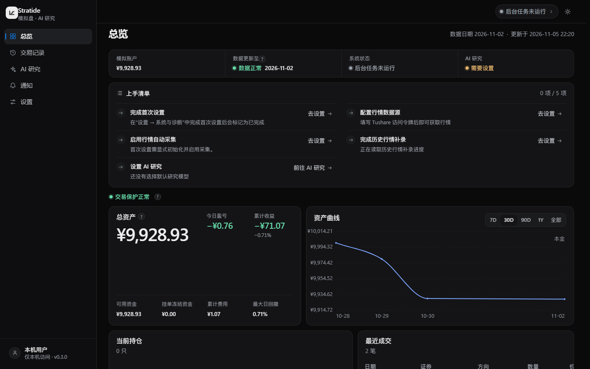
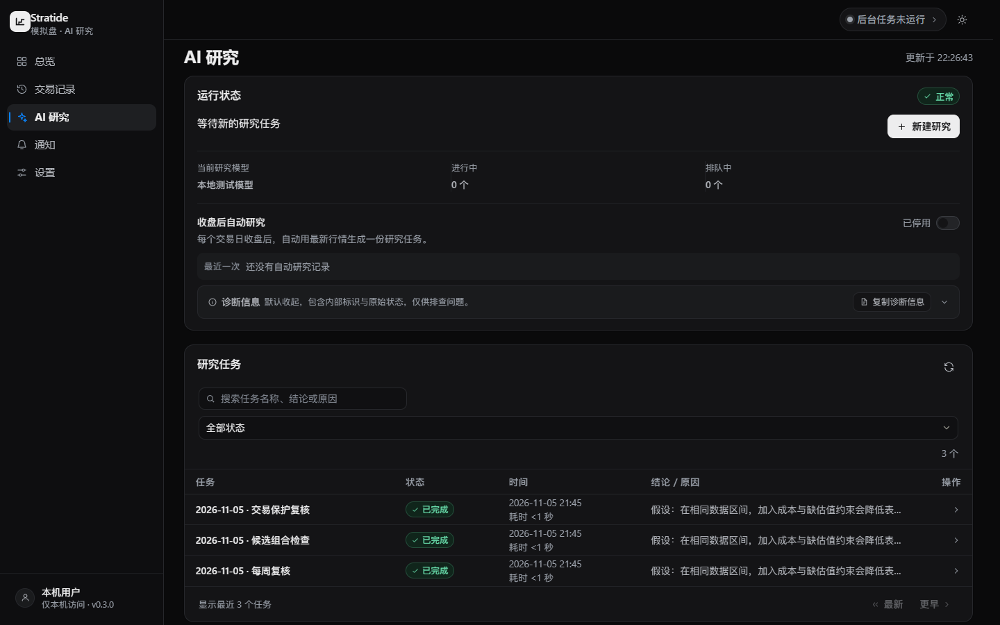

<h1>Stratide</h1>

<strong>A-share research, from market data to paper portfolio.</strong>

A local-first workstation for end-of-day data, automated research, and paper-trading observation.

<a href="docs/WINDOWS_INSTALL.md"><kbd>Windows 11</kbd></a>
<a href="docs/STATUS.md"><kbd>Source v0.3.1</kbd></a>
<a href="docs/KNOWN_LIMITATIONS.md"><kbd>Paper only</kbd></a>

<a href="https://github.com/handFOOLed/Stratide/releases"><strong>Downloads</strong></a> ·
<a href="docs/USER_GUIDE.md"><strong>Getting started</strong></a> ·
<a href="docs/README.md">Docs</a> ·
<a href="README.md">简体中文</a>

UI preview with demonstration data, not an investment-performance claim

## Built for the full research loop

| Market | Research | Portfolio |
| :--- | :--- | :--- |
| **Trusted EOD data** | **Local TimesFM + cloud AI** | **Automated paper trading** |
| A-share universe, incremental collection, source records and quality gates. | Screen broadly, then study a limited candidate set with local forecasts and permission-controlled DeepSeek research. | One cash and risk ledger with frozen intents, assumed fills and auditable positions. |

  

## Get started

1. Check [Releases](https://github.com/handFOOLed/Stratide/releases) for **published** Windows installer assets, install, and double-click **Stratide**.
2. Read and accept the local first-run agreement, then connect your Tushare data source in Settings.
3. For automated research, connect your existing WSL2 / TimesFM environment and configure your AI provider and budget.
4. Explore market status, research tasks, and your simulated account in the Dashboard.

[**Full setup guide (Chinese) →**](docs/USER_GUIDE.md)

> Source on `main` is **0.3.1**. The newest installer asset verified in GitHub Releases is **0.3.0-rc2**. A 0.3.1 installer build was reported locally but its Release upload has not been verified. See [build instructions](docs/WINDOWS_INSTALL.md#从源码构建) for building the current source.

## Docs

[User guide](docs/USER_GUIDE.md) · [Windows installation](docs/WINDOWS_INSTALL.md) · [Architecture](docs/ARCHITECTURE_OVERVIEW.md) · [Documentation index](docs/README.md) · [Troubleshooting](docs/KNOWN_LIMITATIONS.md)

Paper trading only. No brokerage execution, real-money orders, or claims of future investment performance.
