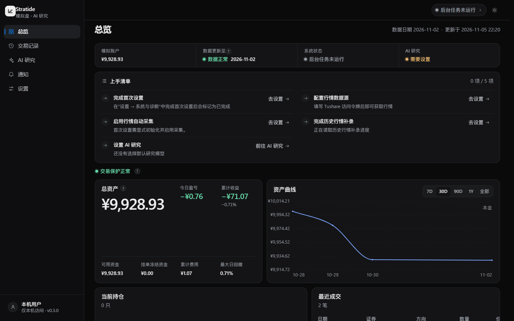
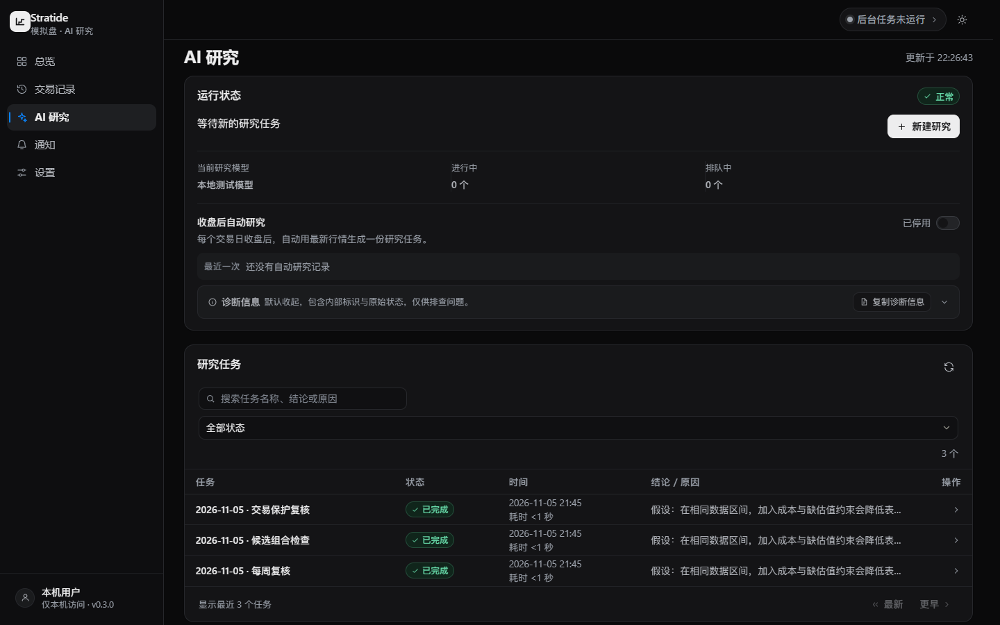

# Stratide

**A-share research, from market data to paper portfolio.**

一个本地运行、自动研究、持续观察的 A 股 Paper Trading 工作台。

[**下载安装**](https://github.com/handFOOLed/Stratide/releases) · [**快速开始**](docs/USER_GUIDE.md) · [文档](docs/README.md) · [English](README.en.md)

Dashboard 界面预览 · 截图使用演示数据，不代表实际投资收益

## 从数据到决策，一处完成

| Market | Research | Portfolio |
| :--- | :--- | :--- |
| **可信盘后行情** | **本地 TimesFM + 云端 AI** | **自动 Paper 模拟** |
| A 股证券池、增量 EOD、数据质量与来源记录。 | 先筛选，再对有限候选进行时序研究与受控 DeepSeek 分析。 | 同一个现金与风险账本，记录冻结意图、假设成交和持仓变化。 |

  

## Get started

1. 从 [Releases](https://github.com/handFOOLed/Stratide/releases) 查看**已上传**的 Windows 安装包，安装后双击桌面 **Stratide**。
2. 首次打开阅读并确认本地使用协议；在 **设置**中配置 Tushare 数据源。
3. 如需自动研究，连接已有的 WSL2 / TimesFM 环境，再配置 AI 服务与费用预算。
4. 在 **总览**、**AI 研究**和**交易记录**中查看行情、研究任务和模拟账户。

**[完整使用指南 →](docs/USER_GUIDE.md)**

> `main` 源码目前为 **0.3.1**。GitHub Releases 中已核实的公开安装附件是 **0.3.0-rc2**；0.3.1 安装包已由开发者在本机构建，但尚未在 Releases 中核实上传。需要当前源码版本请参考 [Windows 构建指南](docs/WINDOWS_INSTALL.md#从源码构建)。

## Documentation

[使用指南](docs/USER_GUIDE.md) · [安装与升级](docs/WINDOWS_INSTALL.md) · [系统架构](docs/ARCHITECTURE_OVERVIEW.md) · [技术参考](docs/README.md) · [故障排查](docs/KNOWN_LIMITATIONS.md)

Stratide 仅提供本地研究与模拟交易，不连接真实券商或执行真钱订单。模拟表现不构成投资建议。
