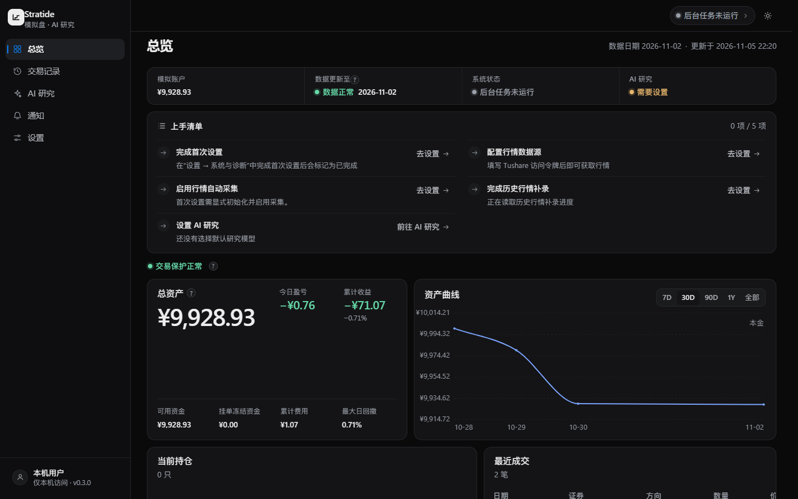

# Dashboard

[← Stratide](../../README.md) · [使用指南](../../docs/USER_GUIDE.md) · [设计系统](../../docs/UI_DESIGN_SYSTEM.md)

Stratide 的 React + TypeScript 前端。**安装版用户无需在此目录执行 npm**；双击 Windows 快捷方式即可打开本地 Dashboard。



## Development

在仓库根目录（Windows + Node 24）：

```powershell
npm --prefix apps/dashboard ci --ignore-scripts --no-audit --no-fund
npm --prefix apps/dashboard run typecheck
npm --prefix apps/dashboard test
npm --prefix apps/dashboard run build
```

前端静态文件由本地 Rust 服务提供，默认端口 `127.0.0.1:8710`。数据、研究任务和 Paper 账本均来自后端 API，**不要**在前端自行计算或修改权威财务状态。

## Design & API

[设计系统](../../docs/UI_DESIGN_SYSTEM.md) · [界面术语](../../docs/UI_TERMINOLOGY.md) · [Dashboard API](../../docs/DASHBOARD_API.md) · [Research Agent API](../../docs/AGENT_API.md) · [截图档案](../../docs/ui-evidence/README.md)

历史 `scripts/start-dashboard.ps1` 是源码调试工具，不是最终安装程序。参见 [V1 完成记录](../../docs/V1_COMPLETION.md)。
