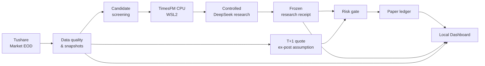
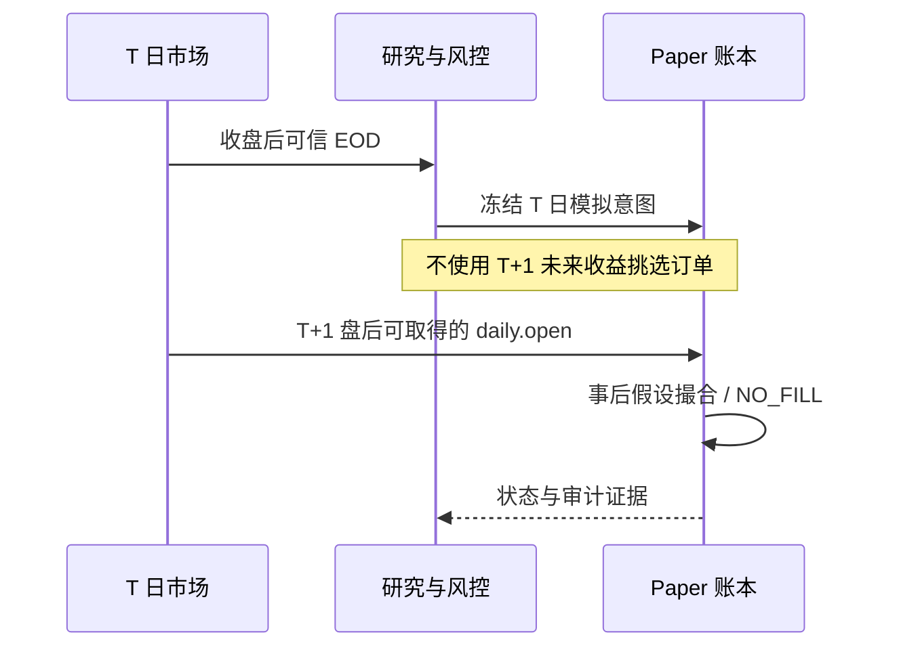

# Architecture

[← 文档](README.md) · [使用指南](USER_GUIDE.md) · [底层架构草案](ARCHITECTURE.md)

Stratide 使用**本地单账户、盘后驱动**的设计。市场数据、研究模型和模拟账本有明确的职责边界，研究结果不能直接改写资金记录。

## One workflow

## 核心边界

| 层级 | 责任 | 不允许做的事 |
| :--- | :--- | :--- |
| **Market** | 收集与校验源日期、覆盖和停复牌等证据 | 伪造数据已在决策时点可得 |
| **Research** | 用 TimesFM 与 DeepSeek 形成可溯源候选 | 直接获得修改资金、持仓或风险限额的权限 |
| **Risk / Execution** | 基于预先固定的模拟策略和风控准入 | 把模型文案当订单或绕过既有风控 |
| **Ledger** | 持久记录共享现金、持仓、模拟成交和拒单 | 建立未经授权的第二个权威账户 |
| **Desktop** | Windows 本地运行、UI、日志与重启恢复 | 默认启动真钱券商交易 |

## 执行时点

**EX_POST_OPEN_ASSUMPTION** 是盘后回看模拟，不是实时开盘报价或真实券商成交。

## Stack

- **Desktop / API** — Rust、Windows 单实例 Launcher / Supervisor、本地 HTTP。
- **Dashboard** — React、TypeScript、esbuild。
- **Research** — Python、WSL2 上的 TimesFM CPU Worker、受权限与费用限制的云端 Provider。
- **Persistence** — 原有权威 SQLite Ledger 与 Agent 数据库，保持独立写入与恢复纪律。

详细接口与原理：[Dashboard API](DASHBOARD_API.md) · [Agent API](AGENT_API.md) · [Risk Policy](RISK_POLICY.md) · [Accepted ADR](adr/README.md)。
