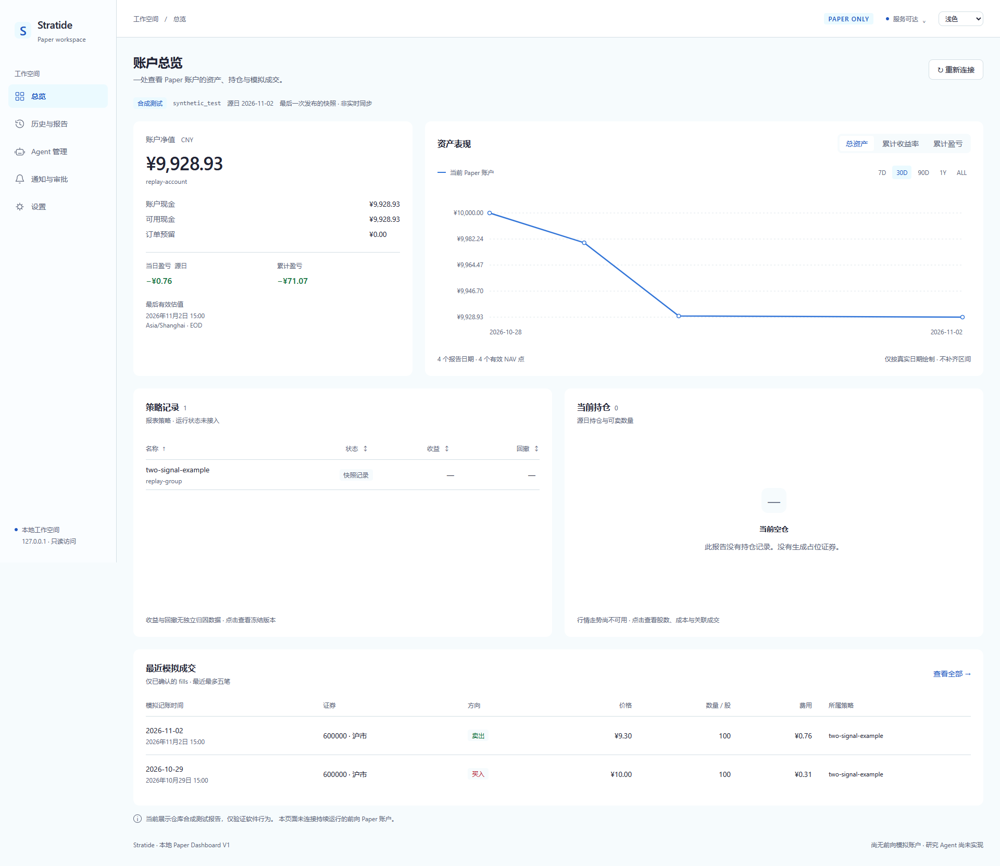
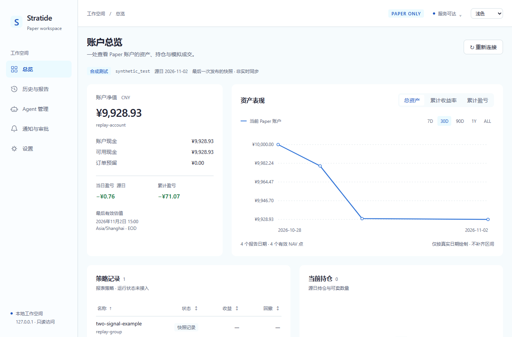

> **当前状态更新（2026-10-29）**：本文保存的是 **PR #21 开发阶段自测记录**；[PR #21 已合并](https://github.com/handFOOLed/Stratide/pull/21)，merge `8591cff46e240bca2eb619378fbef20025c6c9b7`。ChatGPT 在固定 HEAD `3659e4d4` 完成源码审查 PASS；**没有进行 Terra 全量独立复测**，开发者的 Windows/浏览器测试证据不应被改称独立执行。下方原始“Draft / NOT VERIFIED”仅描述**提交当时**的状态，保留原证据链。

# M2-PR01：本地只读 Paper Web Dashboard V1

关联 [Issue #20](https://github.com/handFOOLed/Stratide/issues/20)。实际开发基线：最新 main `a0d8914600717e2bc22bf165025c36dc303947ef`；独立分支 `codex/issue20-dashboard`。**开发、自测完成，Draft；独立验收与小猫同 SHA 审查 NOT VERIFIED，不合并。**

## 已交付

Owner 明确选择的一个完整六报告目录 → 启动时校验并固定内存快照 → 仅绑定 127.0.0.1 的 Rust API → 同源 Vite 前端。总览展示账户 NAV、现金/可用/预留、源日/累计盈亏、真实日期资产曲线、策略记录、持仓、右侧详情抽屉与最近最多五笔确认成交；历史页面区分 fills 和 orders，并提供账户表现与独立研究 Tab。五项导航、主题记忆、独立表头排序、加载/无输入/离线/损坏/缺估值/空仓状态均可交互。

风险分类：P1（财务显示、数据/时效、只读边界），主题/排版为 P2。账本、风控、forward journal、原报告语义和 Accepted ADR 没有修改。daemon 复用现有 contracts/ledger 的数据类型，不调用 Ledger::open、SQLite、回放或撮合。无交易写入、云服务、模型调用、真实券商、远程暴露或子代理。

设计沿用独立 Draft [PR #15 的 Q01–Q69](https://github.com/handFOOLed/Stratide/blob/4109b8d60295947874f0d14575578dbe330c14c6/docs/DASHBOARD_AGENT_DESIGN_DECISIONS.md)，没有合并或覆盖该 PR。PRODUCT/路线图仅协调 Owner 在 paper 阶段开发 Web + Agent 的新要求，并保留历史记录。

## Windows 实测

环境：Windows x86_64、Rust 1.98.1 / MSVC、Node 24.19.0、Python 3.12.10、Microsoft Edge 156.0.4314.50（Chromium）。

```powershell
# 从本分支根目录启动；将路径换为本机既有完整报告目录。
pwsh -NoProfile -File scripts/start-dashboard.ps1 -ReportDir '<Owner明确指定的既有六报告目录>'

# 随仓合成验证样例（不会成为正式服务默认值）
pwsh -NoProfile -File scripts/start-dashboard.ps1 -ReportDir 'docs/evidence/m0-pr03/sample-report'
```

完整脚本已实际完成锁定安装、Vite 构建、Rust 构建、健康检查和默认浏览器打开，地址 `http://127.0.0.1:8710`。含空格参数使用 ProcessStartInfo.ArgumentList 传递。Ctrl+C 停止当前启动的子进程；没有安装服务/计划任务。

| 数据集 | 实测内容 |
| --- | --- |
| 既有 synthetic_test 六报告 | 4 个报告日期，2 笔模拟成交，3 个订单（含 1 个拒单），末日空仓；API/页面保持原字段和原因 |
| 本机既有 historical_replay 冻结输出 | 20260717–20261028，68 日，3 笔模拟成交、3 个订单、末日 100 股；页面 NAV/现金/持仓与原报告完全一致 |
| 显式指定的既有 evaluation.json | 独立档案展示 INSUFFICIENT_EVIDENCE 等原结论；与账户使用不同账本尾摘要，不改变账户 NAV |

68 日原报告来自既有 `issue11-selftest-03/a/report`，没有重新取数或运行策略。原六报告及相邻 ledger 共 **8 个文件的 SHA-256 与修改时间在真实服务刷新/重启测试前后完全一致**；合成源 6 文件同样一致。证据见 [selftest.json](evidence/m2-pr01/selftest.json)。历史行情/六报告/账本及真实历史页面截图只留本机忽略目录，不上传原始价格数据。

## 验证结果

| 实际执行 | 结果 |
| --- | --- |
| cargo fmt --all -- --check | PASS |
| with-msvc.ps1 test --workspace --locked --offline | **117 passed**，其中新增 Dashboard 集成测试 7 项 |
| with-msvc.ps1 clippy --workspace --all-targets --locked --offline -- -D warnings | PASS |
| npm --prefix apps/dashboard run build | PASS，真实 dist 构建 |
| npm --prefix apps/dashboard test | **4 passed**：大整数精确金额/股数、日期范围、空估值折线断点、排序 |
| npm --prefix apps/dashboard run test:browser | **5 passed**：导航/成交与订单分离、主题/区间/排序记忆与抽屉、错误状态、四种宽度截图、真实 68 日账户与独立研究 |
| python scripts/test-dashboard.py --historical-report … --evaluation-file … | 两个实际数据集均 PASS：字段/费用匹配、只读 HTTP、原文件不写、内存固定、相同输入重启一致 |
| 14 个实际文字语义色对 | 最低对比度 5.67:1；深/浅色正常文本均 ≥4.5:1 |

测试覆盖了 NAV=null 不显示为 0、缺字段/坏文件/混合 CSV/收益摘要冲突失败关闭、金额跨 JS 安全整数边界、未成交不计入 fills、研究不合并账户、非 GET 拒绝、任意路径/跨源拒绝、loopback 绑定、忙碌 writer.lock 不影响只读快照、刷新固定和重启一致。

Windows 最后验证期间曾因 Rust 构建与浏览器进程同时占用同一 exe 而构建失败，随后停止测试服务、串行执行，最终全部通过。日志保存在本机 state/issue20-workspace-test.txt 与 state/issue20-clippy.txt；不把这次文件占用当作软件功能通过的证据。

截图来自实际 Chromium 渲染，含 **1920×1080** 与 1366 宽度固定视口，另验证 1280/375 无页面横向溢出。尺寸与结果见 [verification.json](evidence/m2-pr01/verification.json)。实际检查后修正了窄图表坐标文字随 SVG 缩小的问题。





## 数据与未接功能

这是**最后一次发布的静态快照**。网页重新连接不从磁盘择新；新报告发布完成后需明确重启。账户曲线仅来自同一报告，不拼接研究实验。historical_replay 保留探索性/未核验 PIT 标记，synthetic_test 保留引擎测试标签，均不能称为实盘或连续前向表现。当前没有 forward_paper 财务账户，observe-only journal 不能生成收益。

运行状态和独立策略绩效、持仓行情小图、同期基准序列没有可靠输入时显示不可用。研究 Agent、费用预算、通知、审批、业务设置、自动策略准入和远程认证未实现；现有 CLI 导出保留，网页无 CSV/PDF 导出。下一项 Agent 任务可以消费版本化只读报告摘要，但仍需独立任务定义、Owner 授权与 Budget Gate，不能取得本服务不存在的交易写权限。

`/STRATIDE_TUSHARE_TOKEN.md` 精确忽略规则已加入；本机原主工作区该文件原为未提交暂存项，已仅移出暂存区，磁盘文件保留，最终忽略生效且不被 Git 跟踪。未读取、打印或提交凭据内容；未发现该文件的可见提交历史。

跨 Linux/macOS、远程部署、独立验收、连续真实前向财务流水均 **NOT VERIFIED**。完整 [启动/数据契约](../apps/dashboard/README.md)、[API 字段与错误格式](DASHBOARD_API.md) 已保存。
