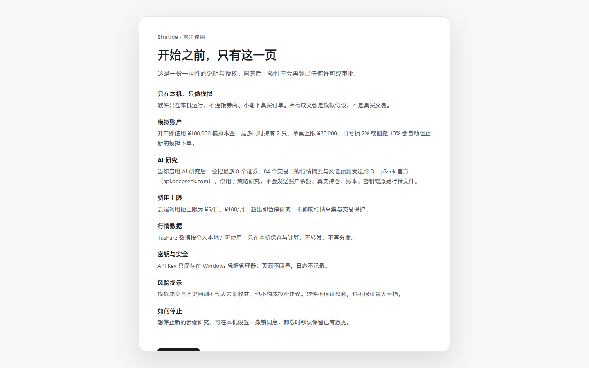
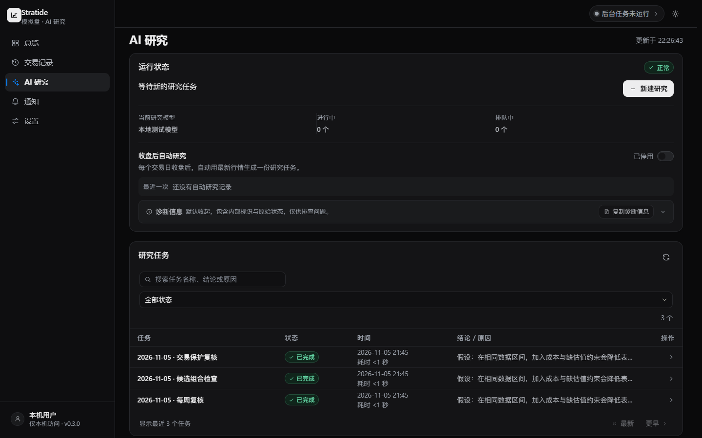
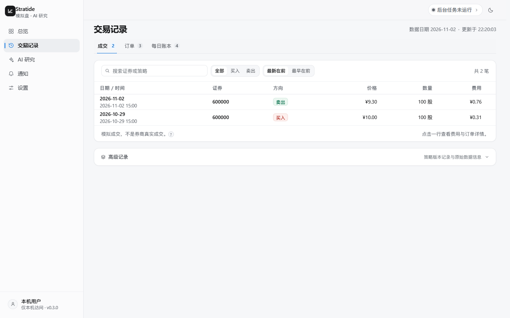

# Getting started · 使用指南

[← 首页](../README.md) · [安装与升级](WINDOWS_INSTALL.md) · [问题排查](KNOWN_LIMITATIONS.md)

**Windows 11 · 本地运行 · Paper only**

下面只列普通用户真正需要的操作。安装程序包含 Dashboard 和常规运行时；TimesFM 权重需要另外准备。

## 01 · 安装并打开

1. 在 [GitHub Releases v0.3.2](https://github.com/handFOOLed/Stratide/releases/tag/v0.3.2) 下载 `Stratide-Setup-0.3.2-x64.exe`，用同页的 `SHA256SUMS.txt` 核对后再运行安装向导。安装包未签名，Windows SmartScreen 可能提示未知发布者。
2. 保留默认安装和数据目录，除非你明确要迁移现有数据。
3. 双击桌面 **Stratide**：启动器会复用或启动本地服务，并在默认浏览器打开 Dashboard。
4. 首次运行会显示使用说明与授权页；阅读其中的**模拟账户设置、AI 数据接收方、费用与风险**后，再自行选择是否同意继续。

当前版本首次启动会自动初始化**本地 Agent 与默认模拟账户**，不再要求用户去文件夹里寻找 Owner 令牌。默认模拟本金为 **¥100,000**；它只是软件里的虚拟资金，不涉及真实入金。

## 02 · 设置行情

在 **设置 → 运行与安装** 中：

1. 保存自己的 **Tushare Token**。
2. 初始化 EOD 行情仓库，填写起始日期（`YYYYMMDD`）。
3. 启用采集，查看最近源交易日、数据覆盖和后台状态。

已启用的后台采集遵循上海市场交易日与原盘后窗口。无需每天手动启动；只有数据质量合格才会进入下一步研究。

使用 **历史补录 → 开始补录** 可补齐历史交易日。设置页会显示启动、下载和仓库校验状态。下载计数达到目标后，仓库覆盖通过校验才显示完成。

## 03 · 连接 TimesFM（可选）

自动本地研究需要你现有的 WSL2 环境、Python 虚拟环境和模型文件。进入 **运行与安装 → WSL2 TimesFM 桥接**：

| 字段 | 示例 |
| :--- | :--- |
| 发行版 | `Ubuntu-24.04` |
| WSL 工作树 | `/home/owner/projects/Stratide` |
| Python | `.venv/bin/python` |
| 模型目录 | `models/timesfm-2.5` |

保存后执行 **检查状态**。引擎忙时，可在当前任务结束后重新检查。后台会按已保存的 WSL 设置重新启动。本地预测依赖 WSL 内已有的模型权重。

## 04 · AI 研究

- 在 **设置 → AI 服务** 添加 API Key。全市场研究使用 DeepSeek；OpenAI 可保存密钥并测试模型列表接口。页面分别列出两项配置。
- 保存 DeepSeek 密钥后，核对官方定价并确认页面列出的计费上限，再配置研究模型。价格确认有效 7 天，到期后付费研究暂停，可在同一页重新确认。
- 使用首次说明页明确许可的研究用途及数据范围。启用模型服务前，确认自己理解**派生行情摘要可能发送至 DeepSeek**，原始行情文件、账本和密钥不应发送。
- 研究预算上限为 **¥5/日、¥100/月**，日上限不得高于月上限。下调至已结算加未结预留以下时，需要单独确认。额度不足以预留单次费用时，付费研究等待可用额度。
- 任务详情仅在存在可恢复的冻结运行且任务确认可安全重试时提供重试。确认后后台会继续处理同一任务。
- 本地 TimesFM 使用连续 **84 个合格交易日快照**形成研究上下文。数据不足、价格证据缺失或模型不可用时会显示具体状态，不会直接把测试研究算作正式结论。

## 05 · 查看模拟账户

总览、交易记录和 AI 研究页面分别回答三个问题：**账户怎样了？发生了哪些模拟交易？研究依据是什么？**

首次创建的默认模拟账户和策略仍受资金、仓位、费用与风控门禁限制。模拟下单的原理是 **T 日盘后冻结意图，在 T+1 日线到达后进行事后开盘价假设成交**；有条件不满足时可能无成交（`NO_FILL`）。模型生成的策略观点不会直接突破风控。

## 06 · 日常使用

| 想做的事 | 入口 |
| :--- | :--- |
| 查看行情与账户 | 总览 |
| 查看自动研究与 AI 费用 | AI 研究 |
| 查看模拟成交、订单、每日账本 | 交易记录 |
| 查看提醒 | 通知 |
| 修改模型、行情与外观 | 设置 |
| 查看后台日志、登录自启 | 设置 → 运行与安装 |

Windows 登录后后台自启可以单独开启；**登录自启不会自动弹浏览器**。随时双击桌面图标即可打开现有 Dashboard。

## 07 · 升级与保留数据

下载安装包升级到相应版本，沿用原安装/数据目录。升级前建议备份模拟账本和研究记录。常规卸载保留用户数据；**删除本地数据**是另一个需要确认的操作。

更完整的安装、诊断和构建步骤见 [Windows 安装与升级](WINDOWS_INSTALL.md)。遇到研究不可用、没有成交、授权或 WSL 问题，请看 [问题排查](KNOWN_LIMITATIONS.md)。
