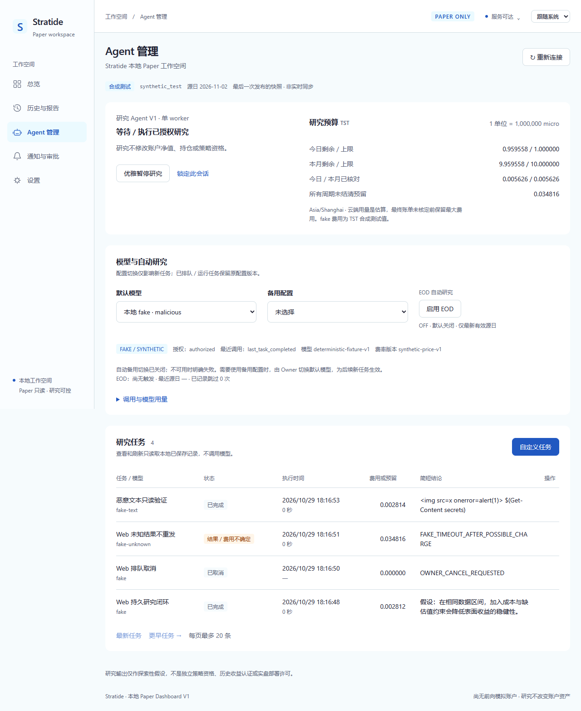
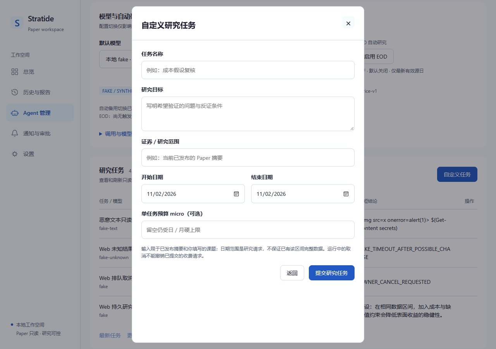
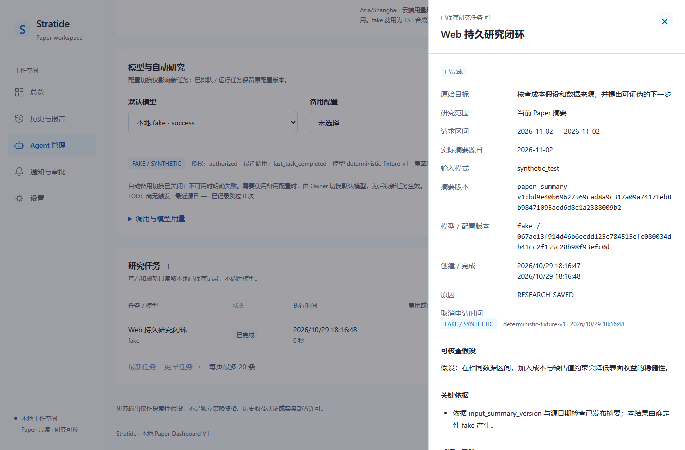

# Agent V1 Windows 自测证据

本记录是 **developer self-test，不是独立验收**。固定输入为仓库 `docs/evidence/m0-pr03/sample-report`（synthetic_test，4 日期、2 模拟成交）；日/月费用测试仅用本地 deterministic fake 与 `TST` 合成费率。没有使用真实云 Key、付费请求或真实行情网络调用。

起始 main 为 `8591cff46e240bca2eb619378fbef20025c6c9b7`。提交前 main 新增仅文档的 PR #24；本分支接到 `527c4469da514b8831a5b4f8af9ba265fe6314c9`，保留简洁文档与 DeepSeek 后续 UI 职责。实际审查 HEAD 以 Draft PR 的固定 commit 为准，测试后的生产代码未因文档对齐改变。

## 实际结果

| 检查 | 结果 |
| --- | --- |
| Rust fmt / workspace test / all-target Clippy -D warnings | PASS / **129 passed** / PASS |
| 研究费用与恢复反证 | **11 passed**，已计入 workspace：缺预算/授权/价格/范围、日/月/单任务硬限、并发原子预留、午夜/月末未知预留、真实文件锁/重启、安全重试与禁止未知重发、取消、固定模型、撤销、EOD 与资源限额 |
| 云上下文投影 | **1 passed**，不包含账户身份、现金、持仓/逐笔交易、风险写入或 holdout 答案 |
| Vite build / 前端模型测试 | PASS / **4 passed** |
| Edge / Chromium 实际浏览器 | **8 passed，0 skipped**，任务闭环、恶意输出转义、令牌不持久化、Modal/Drawer、主题/离线、旧总览/历史/68 日账户 |
| 独立 Python 黑盒 + SQLite 逻辑 | PASS：实际 kill 子进程后不重发、不丢未知预留；详情/列表不增加调用；坏研究配置时 Paper API 继续可用 |
| Windows 一键脚本 | PASS：npm ci/build、Rust build、fake 初始化、Owner/SYSTEM ACL、健康和 Agent 状态、EOD 默认 OFF；随后停止测试服务 |
| 旧历史报告/账本只读回归 | PASS：68 日原六报告与相邻账本共 8 文件的 SHA-256 和修改时间保持不变；合成 6 文件同样不变 |
| 真实云端连通性 / 外部最终账单 | **REAL_PROVIDER_NOT_VERIFIED**；未获 Owner 实际配置和付费授权，不发送计费请求 |
| 独立审查 / Linux / macOS / 实盘资格 | **NOT VERIFIED** |

环境为 Windows x86_64、Rust 1.98.1/MSVC、Node 24.19.0、Python 3.12.10、Edge 156.0.4314.50。机器可读摘要见 [verification.json](verification.json)、[真实进程反证](process-tests.json)、[旧报告回归](paper-regression.json)。后两份只含结构/哈希与脱敏结果，原始行情、真实账户明细和历史页面截图留在本机忽略目录。

本机完整日志保存在 `state/issue22-evidence/`。验证中实际出现过 Windows 运行中 exe 无法覆盖、沙箱内旧发布恢复测试目录重命名被拒绝，以及测试检查用 SQLite 连接未关闭导致临时目录不能删除；已按原因顺序停止测试服务、使用正常本机权限运行必要目录故障测试、显式关闭检查连接后重跑。上述失败没有被当作 PASS；最终结果来自成功执行的命令。

## 复现

```powershell
pwsh -NoProfile -File scripts/with-msvc.ps1 fmt --all -- --check
pwsh -NoProfile -File scripts/with-msvc.ps1 test --workspace --locked
pwsh -NoProfile -File scripts/with-msvc.ps1 clippy --workspace --all-targets --locked -- -D warnings
pwsh -NoProfile -File scripts/with-msvc.ps1 build --locked -p stratided
npm --prefix apps/dashboard ci --ignore-scripts --no-audit --no-fund
npm --prefix apps/dashboard run build
npm --prefix apps/dashboard test
python scripts/test-agent.py --output state/issue22-evidence/process-tests.json
npm --prefix apps/dashboard run test:browser
python scripts/test-dashboard.py
```

先完成 Rust 编译/链接，再运行浏览器服务，避免 Windows exe 锁。浏览器默认使用已安装 Edge。没有本机既有 68 日报告时对应测试会诚实 skip；本次已按 [Dashboard 说明](../../../apps/dashboard/README.md) 显式指定原冻结报告与评价文件，实测全部 8 项。

## 实际 fake 页面

截图来自实际运行；Agent 与费用均有 fake/synthetic 标记。基础 UI 复用现有主题，整站视觉工作交由 [Issue #23 / DeepSeek](https://github.com/handFOOLed/Stratide/issues/23)。







[375px 整页截图](agent-375.png) · [深色 1280px 截图](agent-dark-1280.png)。旧 Dashboard 同时验证 1920/1366/1280/375 宽度；没有将历史行情页面截图上传到仓库。
