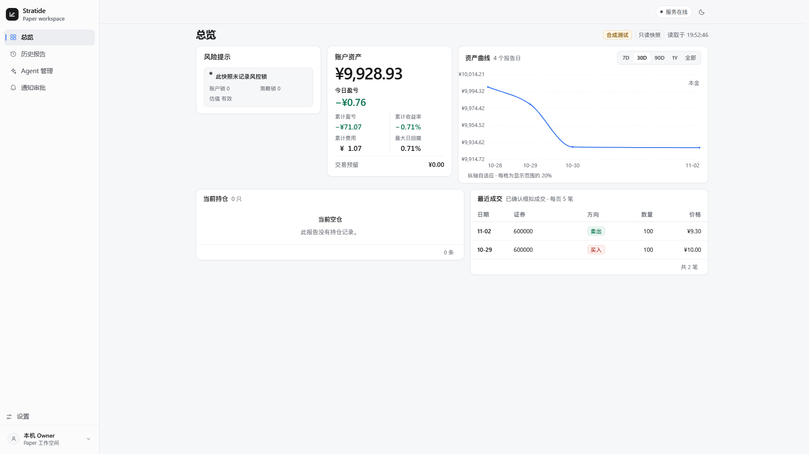
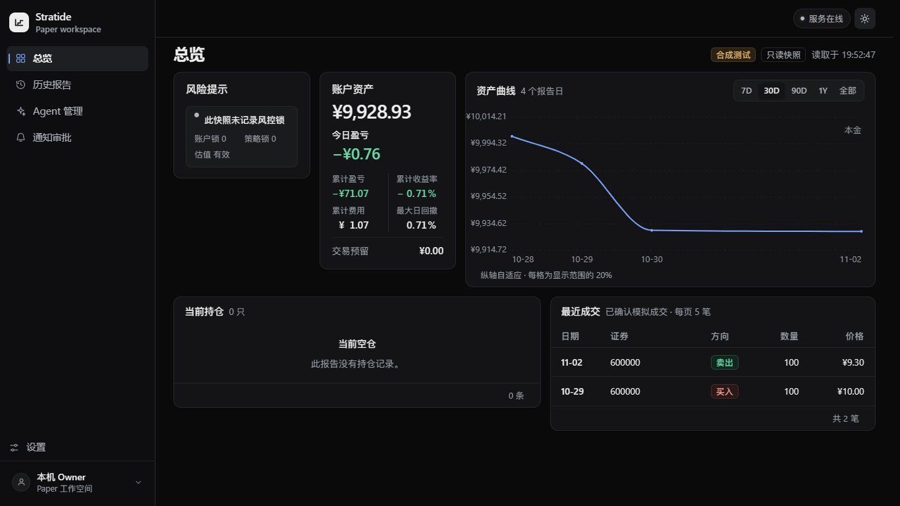

# Issue #77 本地绿测简报

2026-11-04；分支 `codex/issue77-v1-completion`；基线 `62a42993e8b99c29612633b50650d4011f3edcb7`，已含 #75/#78。风险分类：Paper 财务、预算/外发/许可为 P0；持久状态/恢复为 P1；视觉精修为 P2。单 Agent 开发自测，未进行独立验收，未 Ready/merge。

## 已执行

| 检查 | 本地结果 |
| --- | --- |
| `with-msvc.ps1 test --workspace --locked --offline -- --test-threads=1` | **214 passed，0 failed**；原风险、账本、费率/公司行为/历史、Agent/预算和新增 Paper/审批测试均通过 |
| 当前账户定向投影 | 费用/不利一分成交、FIFO 成本、未实现亏损、T+1、外部资金流不算利润、当前与历史 NAV 分离通过 |
| `with-msvc.ps1 fmt --all -- --check` | PASS |
| `with-msvc.ps1 build --workspace --locked --offline` | Windows MSVC PASS；WSL2 原 CPU 环境构建 PASS |
| `with-msvc.ps1 clippy --workspace --all-targets --locked --offline` | 完成；本期新增代码无 Clippy 告警，保留基线 4 项告警，见下文 |
| Dashboard `npm run typecheck` / `npm test` / `npm run build` | PASS / **4 passed** / PASS；未新增依赖 |
| Dashboard `npm run test:browser -- --reporter=line` | **20 passed**，真实本地 Edge：财务格式、分页、空态、风险/来源、主题、键盘/焦点、布局、抽屉、Agent API/取消/零详情调用、reduced-motion |
| 视口/缩放 | 1920×1080 与 1366×768 总览首屏无滚动；1280px/125% 缩放无横向溢出；375px 单列/抽屉、深浅模式通过 |
| 独立临时 WSL 仓库 `python3 -B scripts/test-desktop.py` | **PASS**；synthetic/recorded → 原两笔 TST 任务/调用 → Registry → 持久审批/重启；非 Owner/错 Origin 拒绝、重复 start 409、GET 不增调用 |
| 原实际本地研究 UAT | **PASS**；原真实三证券 TimesFM、原合成研究、OOS、原 Registry 可读；新合成 CPU 批次实际执行与实际取消均通过；页面任务抽屉无异常 |
| 真实来源外发反证 | **REAL_MARKET_DATA_EGRESS_DENIED**；本期 0 新真实云调用、0 新行情请求；原 CNY 预算前后完全一致 |
| 通知/审批 UI | 实际本机解锁、审批记录、五秒标已读撤销/最终持久已读、设置证据表可用，0 pageerror |
| `python -X utf8 -B scripts/test-local-backup.py -v` | **2 passed**；SQLite integrity/SHA、dry-run 不落盘、新目录恢复、原 token 保留、篡改/路径逃逸/覆盖拒绝、不 autorun |
| Windows 原生启动脚本 | start → health/status → stop → restart → stop PASS；显式新 synthetic Agent，旧数据未动 |
| Windows 调用已有 WSL2 工作树 | start → localhost health → 原研究 UAT → stop PASS；CPU stop 后 `STOPPED` |

Windows 本次测试把 TEMP/TMP 设到本工作树 `state/issue77/test-temp`；默认临时目录在本会话沙箱中曾拒绝访问。没有删断言或把这类失败当成业务 PASS。旧 loopback 测试在 Windows 的 accept 会继承 listener 非阻塞状态，已在测试服务器显式恢复阻塞读取，生产 Provider 代码未改。

严格 `clippy ... -- -D warnings` **未通过**：基线 `provider.rs` 的 `large_enum_variant`、`risk_binding.rs` 两处 needless borrow、`structured.rs` 的 needless question mark。已通过 `git show` 核实这些代码原在基线，本期未修改或加 allow 压掉。文件系统另有 Rust 增量缓存 hard-link 失败后正常复制的构建提示，不影响编译/测试结论。

审批重启反证保留 `outcome_uncertain` 且不能重启已消费许可；CPU 取消沿原任务写入终态。Paper 反证覆盖无前日冻结、冻结后改选、错日/过早取得、缺 SHA/公司行为/状态、账户风险冻结以及重复事件不重复成交。原 v3/v4 账本保持摘要兼容，不做迁移。

## 渲染截图（全部 synthetic_test）

已实际检查下列渲染图；固定样例中的 ¥9,928.93 是仓库合成数据，不是 Owner 资金。

[375px 设置页，合成测试](设置-375-浅色-合成测试.png)。原实际研究页面只在本机测试，未提交其中真实报告、来源正文或私有配置截图。

## 交付与限制

软件集成状态为 `V1_ENGINEERING_COMPLETE`，Draft 待 Owner 决定。配置/启动/停止、Paper 输入及备份恢复步骤见 [V1_COMPLETION](../../V1_COMPLETION.md)。使用新功能前 Owner 仍需在本机指定原目录和已冻结操作、当前 Paper 本金/风险配置；新接收方或新真实数据外发授权不在本期取得。

没有读取 Tushare/DeepSeek 密钥正文、改写原两笔真实调用/预留、搬迁原库/权重/凭据或运行真实付费研究。原数据和 Owner 旧工作树保留；新实验状态、构建产物、SQLite、模型、原行情、私有报告及日志不提交。

#10/#17 保持开放。历史 PIT、真实开盘流实收、连续前向成交、已验证收益与交易资格仍 **NOT_VERIFIED / BLOCKED**。本期没有真实前向成交或真钱 Broker Call；`EX_POST_OPEN_ASSUMPTION` 不能替代这些证据。N100/Linux 服务器/物理断电长稳已按 Owner 范围排除，不构成 V1 功能阻断。
